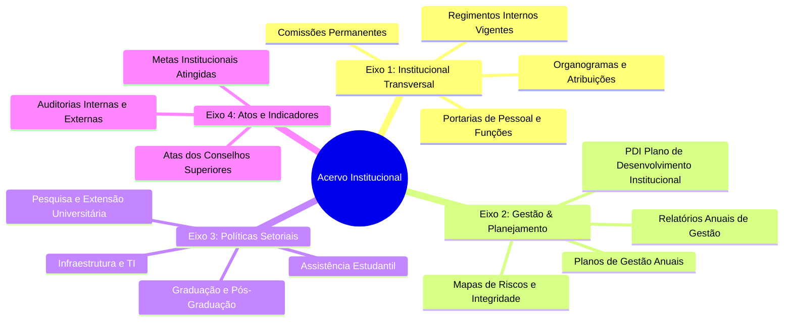

<div align="center">

# 🏛️ Governança Documental e Conformidade Regulatória
### Pró-reitorias e Superintendências da UFPR

**Padronização, Auditoria e Gestão do Acervo Normativo para Avaliações MEC/SINAES**

[](https://www.ufpr.br)
[](#)
[](#-contexto-e-marco-normativo)
[](#-documentos-dispon%C3%ADveis)

</div>

---

## 📌 Contexto e Objetivo

No âmbito da gestão pública universitária, a integridade, rastreabilidade e tempestividade dos documentos institucionais são requisitos cruciais tanto para a **governança interna** quanto para os ciclos de **avaliação institucional externa e recredenciamento do Ministério da Educação (MEC/SINAES)**.

Este repositório estabelece o arcabouço técnico e procedimental de **Gestão Documental** desenvolvido para apoiar e orientar as **Pró-reitorias** e **Superintendências** da Universidade Federal do Paraná (UFPR). O objetivo é padronizar a coleta, organização taxonômica e validação de relatórios, portarias, organogramas, planos de ação e normativas internas.

---

## 📑 Documentos Disponíveis

```text
├── Manual_de_Requisitos_Documentais.md     # Guia orientativo consolidado de requisitos e taxonomias
├── Formulario_Coleta_Documentos.md         # Instrumento padronizado para levantamento junto aos setores
└── README.md                               # Documentação institucional do repositório
```

---

## 🏛️ Eixos Temáticos de Documentação

A estrutura normativa foi desenhada com base em eixos de conformidade que garantem a cobertura integral dos indicadores de avaliação:



---

## 📋 Detalhamento dos Componentes

### 1. Manual de Requisitos Documentais ([`Manual_de_Requisitos_Documentais.md`](Manual_de_Requisitos_Documentais.md))
- **Padronização Taxonômica:** Regras de nomenclatura de arquivos digitais em PDF (ex.: `SIGLA_TIPO_ANO_VERSAO.pdf`).
- **Eliminação de Redundâncias:** Consolidação de diretrizes transversais obrigatórias a todas as unidades administrativas.
- **Checklist de Auditoria:** Roteiro prático para comissões locais verificarem a conformidade antes do envio aos avaliadores do MEC.

### 2. Formulário Oficial de Coleta ([`Formulario_Coleta_Documentos.md`](Formulario_Coleta_Documentos.md))
- **Identificação e Responsabilidade:** Registro formal do servidor responsável pelo setor.
- **Campos Estruturados de Coleta:** Mapeamento de links, números SEI (Sistema Eletrônico de Informações), status de vigência e justificativas de ausência.
- **Termo de Responsabilidade:** Declaração de conformidade com as políticas institucionais e a **LGPD (Lei Geral de Proteção de Dados)**.

---

## 🔒 Governança de Dados e Conformidade LGPD

O processo de coleta e disponibilização de documentos segue os preceitos da **Lei nº 13.709/2018 (LGPD)** e da **Lei de Acesso à Informação (LAI - Lei nº 12.527/2011)**:
- **Minimização de Dados Pessoais:** Tarjamento (*redaction*) de dados pessoais sensíveis e números de documentos de identificação civil em atos públicos irrestritos.
- **Transparência Ativa:** Priorização da guarda e disseminação de informações de interesse coletivo ou geral.
- **Trilha de Auditoria:** Rastreabilidade dos responsáveis pela submissão e alteração de arquivos no repositório documental.

---

## 👥 Público-Alvo e Aplicação

- **Equipes de Pró-Reitorias e Superintendências:** Guia operacional para catalogar e entregar o acervo documental.
- **Coordenadorias de Avaliação e Indicadores:** Parâmetro unificado para inspeções e pré-avaliações in loco.
- **Pesquisadores em Gestão da Informação:** Estudo de caso de arquitetura da informação e governança documental no setor público.

---

<div align="center">
Desenvolvido por <strong>Bruno Marafiga</strong><br>
Curso de Gestão da Informação • Universidade Federal do Paraná (UFPR)
</div>
